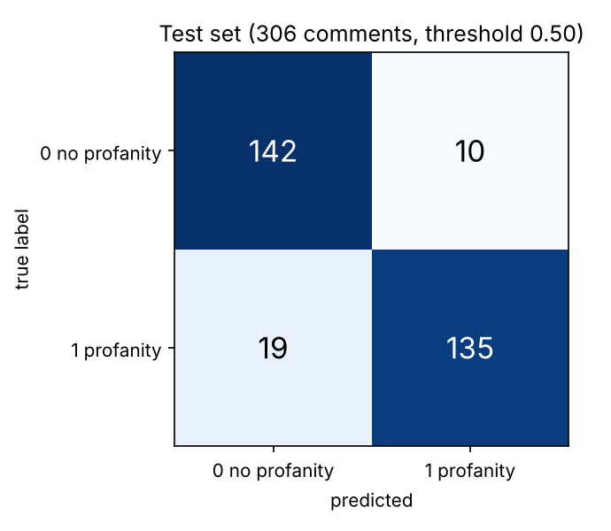

# Kazakh Profanity Detection

DSSC5113 Deep Learning · Bonus project · Fall 2026
**Author:** Arlen Maker · **Student ID:** ✏️ *(add your ID)*

A small character-level CNN, trained from scratch, that reads one Kazakh review or comment and predicts whether it contains Kazakh profanity:

- **Input:** one comment or sentence (Cyrillic or Latin script, mixed languages allowed).
- **Output:** `label` (0 = no profanity, 1 = profanity) and `probability` = P(profanity).

| Held-out test set (306 comments) | Precision | Recall | F1 | Accuracy |
|---|---|---|---|---|
| Profanity class, threshold 0.50 | **0.931** | **0.877** | **0.903** | 0.905 |

The trained model is in [`models/`](models) (0.4 MB), so you can predict without retraining:

```bash
pip install -r requirements.txt
python predict.py "Мал ойын екен" "Керемет қосымша, маған ұнады"
# 1 (profanity)  P(profanity) = 0.9999  |  Мал ойын екен
# 0 (no profanity)  P(profanity) = 0.0022  |  Керемет қосымша, маған ұнады
```

Or open [`notebooks/Kazakh_Profanity_Colab.ipynb`](notebooks/Kazakh_Profanity_Colab.ipynb) in Google Colab: it predicts on your own text and can rerun the whole pipeline.
[](https://colab.research.google.com/github/Kombokonina/kazakh-profanity-detection/blob/main/notebooks/Kazakh_Profanity_Colab.ipynb)

---

## 1. Data

### Source and how it relates to product reviews

The comments come from **[KazSAnDRA](https://github.com/IS2AI/KazSAnDRA)**, the Kazakh Sentiment Analysis Dataset of Reviews and Attitudes (Yeshpanov & Varol, LREC-COLING 2024; 180,064 public reviews; **CC BY 4.0**). Its reviews are about apps and games, goods on online marketplaces, places on maps, and books. The participants of this bonus project collectively selected **3,061** of these reviews and labelled them for profanity. That shared file is included here as [`data/kazakh_profanity_share.csv`](data/kazakh_profanity_share.csv) (columns `kazsandra_id, text, label, split`), with personal details masked (see Privacy).

| Review domain (from the KazSAnDRA id) | Comments | With profanity |
|---|---|---|
| App store: Google Play reviews of apps and games (`pla…`) | 2,724 | 1,520 |
| Marketplace: reviews of goods (`kas…`, `fli…`) | 191 | 2 |
| Mapping: reviews of shops, clinics, places (`gis…`, `map…`) | 95 | 10 |
| Bookstore: reviews of books and audiobooks (`kit…`) | 51 | 6 |

App and game reviews are reviews of digital products and use the same informal style as comments about goods: short, emotional, often mixed Kazakh–Russian, sometimes in Latin script. Almost all profane comments come from the app store, though; only 2 of the 191 marketplace reviews are profane (see Limitations).

**No synthetic examples.** [`verify_source.py`](verify_source.py) checks every row against the original KazSAnDRA files: all 3,061 ids exist, 3,002 texts are identical, and the other 59 differ only where usernames, a phone number or personal details were masked. No example was written or generated by us.

**Access.** The data is in this repository, so no download is needed. The original is at https://github.com/IS2AI/KazSAnDRA (files `dataset/*_sc_*.zip`); `verify_source.py` shows how to look our ids up there.

### Labelling rules

**Label 1 (profanity)** if the comment contains at least one of these:

- **1a. Obscene or vulgar words** about sex, genitals or excrement, and their derivatives: e.g. қотақ, ам, сік-/сіг-, шешеңнің амы, көт, боқ (used as swearing).
- **1b. Abusive insults** aimed at a person, group or the product: e.g. мал, есек/ешак, ит, чорт, лох, ақымақ, малский/малыски.
- **1c. Any spelling of these**: masked (с*ка, қот@қ, б**ть), shortened (шшс, щщс, зб), stretched (Көтттт), misspelled (котак, тасақ, зайбал) or in Latin script (qotaq, am, pizdes).
- **1d. Mixed-language swearing**: Russian (or English) obscene words inside a Kazakh comment count (говно, нахуй, сука, бля), because they are profanity on a Kazakh review page.

**Label 0 (no profanity)**:

- **2a. Negative reviews without such words**: «Жамаан ойын», «Өте нашар, ақшамды қайтарыңдар». A negative review is not automatically profane.
- **2b. Literal meanings**: мал = livestock, ит = dog the animal («мал шаруашылығы», a quiz answer «ит»).
- **2c. Talking about swearing without swearing**: «Боқтаудыда … үйрендік» (we learned swearing from TikTok).
- **2d. Look-alike words**: сикунд (a misspelling of секунд), Сіге (Сізге), қотарылмайды (won't download).

**Ambiguous cases** (unclear target, possible jokes, rare slang or codes such as «667»): we kept the group's label unless it clearly broke the rules above.

**Labelled examples**

| Comment | Label | Why |
|---|---|---|
| Мал ойын | 1 | insult (1b) |
| Маған ұнайды бляя😎😎 | 1 | positive review with Russian swearing (1d): profanity ≠ negativity |
| Кымбаттап кетипти говно | 1 | Russian obscene word in a Kazakh comment (1d) |
| Б** з@еб@**л мына ойын | 1 | masked swearing (1c) |
| pizdes eken bargo 😁✊👍 | 1 | Latin script (1c) |
| Жамаан ойын | 0 | negative but not profane (2a) |
| Маңғыстауда мал жоқ па? Дым шықпайды ғой | 0 | мал = livestock (2b) |
| Боқтаудыда,Иманды болудыда ттдан үйрендікқо | 0 | talks about swearing (2c) |

Profanity is not the same as negative sentiment: in KazSAnDRA's own star ratings, 590 of the profane comments are 5-star reviews, while 538 clean comments are 1-star reviews.

### Label checks and fixes

The shared data came as an XLSX and a CSV export, which disagreed on 5 labels, all about «мал»-like words. The XLSX was right in 4 of the 5 (literal «мал шаруашылығы» = 0, the insult «Малски ойын» = 1), so **we use the XLSX labels**. For the fifth, «Малғұн ит Цукерберг» (an insult), we used the CSV label 1. Then we checked the labels in two ways. `python check_labels.py` prints both lists:

1. **Keyword check, all rows:** comments labelled 0 that contain a clearly obscene word. It finds 6: 2 real errors, 3 false hits (the stem «ебан» inside «фортебанк», «бля» inside «дубляж») and one error we noticed too late (see below).
2. **Baseline review, training and validation only:** a simple character TF-IDF + logistic regression model is trained with 5-fold cross-validation on train + val, and we read the 60 comments where it disagrees most with the label. The test set is **not** part of this review, so no test label was changed to agree with a model.

Most flagged comments were labelled correctly (variants such as «Тасак», «шшс», a swear word at the very end of a long comment). We fixed **7 clear errors**, listed with reasons in [`data/label_fixes.csv`](data/label_fixes.csv): 4 changed from 0 to 1 and 3 from 1 to 0. Only one of them is in the test set (`pla002685pla`), and its fix comes from the XLSX/CSV disagreement, not from a model. `prepare_data.py` applies the fixes.

**One known error left.** The training comment `pla012970pla` («…сабак окыимн заибал бан жбереиы барымыз») is labelled 0, but «заибал» (from Russian «заебал») is profanity under rule 1c, and 125 of the 126 training comments with «заибал», «зайбал» or «заебал» are labelled 1. We noticed it only after the final test run and left it unchanged, so that the data matches the saved model.

### Privacy

The shared file had already replaced some usernames with `@user` and one phone number with `<phone>`. We found and masked personal details in **53 more comments**:

- social-media and app usernames and a channel name → `@user`;
- first names or full names of reviewers, staff (doctors, teachers, sellers and other employees), children and other private persons → `<name>`;
- birth years, schools, a town and a home address → `<year>`, `<school>`, `<place>`.

[`data/privacy_masks.csv`](data/privacy_masks.csv) lists where we masked and what kind of detail was removed, never the original text. Names of public figures (politicians, athletes, writers) were kept. We searched with lists of common Kazakh first names, phrases such as «менің атым» (my name is) and «деген» (named), job titles and capitalised words, and read every hit.

### Duplicates, near-duplicates and splits

`prepare_data.py` does the following, with **seed 5113**:

1. **Removes exact duplicates.** Two comments are the same if only letter case or spaces differ. This removed 2 rows (3,061 → 3,059).
2. **Groups near-duplicates.** Each text is reduced to letters only, with repeated letters collapsed («Көтттт!!» → «көт»). Two comments are near-duplicates if their 3-letter pieces overlap by at least 80% (Jaccard index). This found 14 groups with 30 comments, for example «Қотақбас» / «Қотақбассссс» and «Мал ойын» / «мал ойынннннн👎👎👎👎👎👎» / «Мал ойын1111111111222».
3. **Splits by group**, stratified by label, using `StratifiedGroupKFold(n_splits=10, shuffle=True, random_state=5113)`: one fold for test, one for validation, eight for training. A near-duplicate group never crosses splits (the script checks this).

| Split | Comments | No profanity (0) | Profanity (1) |
|---|---|---|---|
| train | 2,447 | 1,218 | 1,229 |
| val | 306 | 152 | 154 |
| test | 306 | 152 | 154 |
| **total** | **3,059** | **1,522** | **1,537** |

We did not use the `split` column of the shared file: it had no documented seed, it let near-duplicates cross splits (the same long «Ассалаумағалейкум…» review was in both train and val), and its class balance differed between splits (48% profane in train, 59% in val and test). Our split files are in [`data/processed/`](data/processed), with a summary in `split_summary.json`.

---

## 2. Model

### Why a character-level CNN

Profanity here is mostly about **which letter patterns appear**, and those patterns are spelled in many ways: masked with `*` or `@`, stretched, shortened, misspelled, in Cyrillic or Latin, mixed with Russian. A word-level model would see most of these as unknown words. A character model sees every spelling, and its convolution filters learn short letter patterns («қот», «сік», «нах», «с*к») wherever they occur. With about 2,400 training comments, a small model (105,649 parameters) trains in about 2 minutes on a CPU, is fully reproducible and fits in the repository.

For comparison, a simple non-neural baseline (character TF-IDF + logistic regression, part 3 of `check_labels.py`) reaches validation F1 0.906, against 0.931 for the CNN. A pretrained transformer (multilingual or Kazakh BERT) could understand context better, but needs a large download and a GPU; we list it as an improvement.

### From raw text to prediction (one comment traced)

`«МАЛ ОЙЫН!!!!!»`

1. **Normalize** ([`textproc.py`](textproc.py)): Unicode NFKC, lowercase, 3 or more repeated characters → 2, tidy spaces → `«мал ойын!!»`. Punctuation, digits and emoji are **kept**, because `*` and `@` often hide swear words.
2. **Character ids** from [`models/vocab.json`](models/vocab.json), which was built from the **training set only**: `[92, 80, 91, 2, 94, 89, 107, 93, 3, 3]` (10 characters; 2 is the space, 3 is «!»). Characters seen fewer than 2 times in training, and any new character (for example the emoji ☃), become the unknown id 1. Id 0 is padding.
3. **Embedding:** each id becomes a learned vector of 48 numbers → a tensor of shape (1, 10, 48).
4. **Convolutions** ([`model.py`](model.py)): 3 × 128 filters with widths of 3, 5 and 7 characters slide over the comment, followed by ReLU → three tensors of shape (1, 128, 10). Each filter is a learned pattern detector.
5. **Max pooling over the comment:** each filter keeps its strongest match anywhere in the text → 384 numbers. This works for any length, a swear word counts the same at the start or at the end, and padding is ignored.
6. **Dropout 0.5** (training only), then **Linear(384 → 1)** gives one number, the logit 8.33. **Sigmoid** turns it into P(profanity) = 0.9998.
7. **Threshold 0.50**, chosen on validation: 0.9998 ≥ 0.50 → label **1**.

**Long comments.** The median comment has 38 characters. Only one training comment (1,054 characters) is longer than the 1,024-character input limit, and training uses its first 1,024 characters. When predicting, [`predict.py`](predict.py) splits longer inputs into overlapping 1,024-character windows (step 512) and takes the highest probability, so the end of a long comment is never cut off.

### Training settings

All settings are in [`config.json`](config.json). Seed **5113** is used for Python, NumPy and PyTorch, and for shuffling the training batches.

| Setting | Value |
|---|---|
| Embedding size / filters / filter widths | 48 / 128 per width / 3, 5, 7 |
| Dropout | 0.5 |
| Loss | binary cross-entropy on the logit (`BCEWithLogitsLoss`) |
| Optimizer / learning rate / batch size | Adam / 0.001 / 32 |
| Epochs | up to 30; keep the epoch with the best **validation F1**; stop after 6 epochs without improvement |
| Decision threshold | the value from 0.05–0.95 (step 0.05) with the best validation F1 (ties → closest to 0.5) |
| Result | best epoch **15** of 21, threshold **0.50**, 265 character ids |

Validation (306 comments) at the chosen epoch and threshold: precision 0.946, recall 0.916, **F1 0.931**. Training is deterministic on CPU: running the whole pipeline twice gave identical files (splits, model, metrics). The training curves are in [`results/training_curves.png`](results/training_curves.png), and the per-epoch log in `results/training_log.csv`.

---

## 3. Results on the test set

The test set was used only after the epoch and threshold were fixed on validation ([`evaluate.py`](evaluate.py)); see also the transparency note below.

| Test examples | Precision (profanity) | Recall (profanity) | F1 (profanity) | Accuracy |
|---|---|---|---|---|
| 306 | 0.931 | 0.877 | **0.903** | 0.905 |



| | Predicted 0 | Predicted 1 |
|---|---|---|
| **True 0** (152) | 142 correct | **10 false positives** |
| **True 1** (154) | **19 false negatives** | 135 correct |

Bootstrap 95% intervals (2,000 resamples of the saved test predictions): F1 0.864–0.935, precision 0.887–0.970, recall 0.820–0.925. With 306 test comments, differences of a few points between models are within noise.

By domain: app store 244 of 272 correct, marketplace 21 of 21, bookstore 6 of 6, mapping 6 of 7. All 154 profane test comments are app-store reviews, so the other domains only show that clean reviews were not flagged. By length: 89–93% correct up to 160 characters, but only 22 of the 27 longer comments (81%).

All saved outputs are in [`results/`](results): `test_metrics.json`, `confusion_matrix.png` and `test_predictions.csv` (every test comment with its probability).

### What the errors mean for moderating reviews

- **False positive** (a clean comment predicted profane): an honest review, often a negative one, gets hidden or flagged. The customer feels censored, and the shop or app looks like it hides criticism.
- **False negative** (a profane comment predicted clean): swearing stays visible to every reader, including the many children who read app and game reviews.

Which error matters more depends on what happens to a flagged comment. If the system **deletes automatically**, false positives are worse, so use a high threshold. If it **sends comments to a human moderator**, false negatives are worse, so use a low threshold. On **validation**:

| Threshold | Precision | Recall |
|---|---|---|
| 0.3 | 0.900 | 0.935 |
| 0.5 (chosen) | 0.946 | 0.916 |
| 0.9 | 0.992 | 0.792 |

A practical policy: hide automatically above 0.9, send 0.3–0.9 to a moderator, and publish below 0.3.

### Error analysis

"Without X" means we deleted that word and ran the model again (you can repeat this with `predict.py`).

| # | Test comment | True | P(profanity) | Why the model was wrong |
|---|---|---|---|---|
| 1 | «өте күшті емес **сука**» | 1 | 0.013 | One swear word among clearly positive words. All 37 training comments with «сук…» are profane, but almost all of them contain several other swear words. Here «өте күшті» (very cool) wins: without «күшті», P = 0.38. |
| 2 | «**Ам** сияқты ұнады👍» | 1 | 0.008 | «ам» has only 2 letters and also sits inside clean words (адам, тамаша), while «ұнады» (liked) is a strong clean signal: without «ұнады👍», P = 0.25. |
| 3 | «Wws **amshyk** samokat **ebanuty** … **sigip** …» | 1 | 0.115 | Latin script: only about 75 training comments are mainly in Latin letters. |
| 4 | «Управлениясын создаватеткен киши **гондон**» | 1 | 0.052 | A new spelling: «гондон» never appears in training; «гандон» appears 4 times, always next to other swear words. |
| 5 | «Неге **қотар**лмайды» (why won't it download) | 0 | 0.975 | A look-alike: «қотару» (to download) never appears in training, while «қотақ» and its spellings are in 297 training comments, all profane. |
| 6 | «Маңғыстауда **мал** жоқ па? Дым шықпайды ғой» | 0 | 0.989 | Literal «мал» (livestock): 9 in 10 training comments with the word «мал» are profane, and the model can't read the meaning from context. Without «мал», P = 0.67. The CSV export even labelled this comment 1. |
| 7 | «Маскарасындаргой,акцияларын ужасный **далбаса**» | 0 | 0.949 | Two look-alikes. «далбаса» (nonsense) alone gets 0.98 because it begins like the Russian obscene «далбаёп» and its spellings (36 training comments, all profane). «Маскарасындаргой» (you're a disgrace) alone gets 0.91 because it ends like insults such as «малсыңдар ғой». |
| 8 | «Супер Боди (&68587 **\*^\*^**86676465…» | 0 | 0.746 | `*` usually hides a swear word: 43 of the 51 training comments with `*` are profane. Without «\*^\*^», P = 0.27. |

So misses come from a single swear word among clean words, very short swear words, Latin script and new spellings. False alarms come from look-alike letters, literal meanings and masking symbols. The model also gives high scores to some harmless **single words** (e.g. «Кітап», book: 0.95), because 69% of the training comments up to 10 characters are profane.

**Practical improvements**, in order of expected value:

1. **Targeted data:** clean comments with look-alike and literal words (қотару, көк, мал шаруашылығы, далбаса), harmless short comments, and more comments with a single swear word.
2. **Augmentation:** copies of training comments in Latin script, letters randomly masked with `*`, and one swear word inserted into a clean comment.
3. **Labels:** a second annotator for mild or slang words (далбаса, боқ, ит, codes like 667), using the rules above.
4. **Model:** fine-tune a pretrained multilingual or Kazakh transformer to tell literal from insulting uses.
5. **Deployment:** the two-threshold policy above, with a human moderator for the middle range.

### Sample predictions

From the test set (`results/test_predictions.csv`):

```text
1 (profanity)     P = 0.9950 | Көшірінбейд виртка кірейін десем мал мал телеграм плей маркет мал   (correct)
0 (no profanity)  P = 0.0283 | МАГАН тик ток унады😊                                              (correct)
0 (no profanity)  P = 0.1939 | Ой керемет шіркін, не деген бакылау … Каспий арқылы …               (correct: sarcastic but clean)
0 (no profanity)  P = 0.0128 | өте күшті емес сука                                                 (wrong, see #1)
```

`predict.py` on new text:

```text
0 (no profanity)  P(profanity) = 0.0018  |  Керемет ойын, маған қатты ұнады
1 (profanity)  P(profanity) = 0.9999  |  Мал ойын екен
0 (no profanity)  P(profanity) = 0.0323  |  Өте жаман қосымша, ақшамды қайтарыңдар
1 (profanity)  P(profanity) = 0.9966  |  Qotaq oyin
0 (no profanity)  P(profanity) = 0.1695  |  Мал шаруашылығына арналған жақсы кітап
0 (no profanity)  P(profanity) = 0.4994  |  с*ка не ашылмайды      <- masked swear word, just below the threshold
1 (profanity)  P(profanity) = 0.9503  |  Кітап                  <- false alarm on a single harmless word
```

### Transparency note

We trained and evaluated on the test set **three times**, with the same code, settings and seed. The only change between runs was privacy masking: after run 1 we found personal details in 12 comments, and after run 2 in 41 more. Masking changes a few characters, so the model changes slightly. No setting was changed after seeing a test result, and we report run 3, which we chose as final before seeing its result.

| Run | Comments we masked | Best epoch | Val F1 | Test precision | Test recall | Test F1 |
|---|---|---|---|---|---|---|
| 1 | 0 | 19 | 0.925 | 0.944 | 0.870 | 0.905 |
| 2 | 12 | 15 | 0.931 | 0.919 | 0.883 | 0.901 |
| **3 (final)** | **53** | **15** | **0.931** | **0.931** | **0.877** | **0.903** |

Test F1 moved by at most 0.004 between runs, which shows the normal variation from small data changes.

---

## 4. How to run

### Local setup (Python 3.12 or newer)

```bash
git clone https://github.com/Kombokonina/kazakh-profanity-detection.git
cd kazakh-profanity-detection
python -m venv .venv
source .venv/bin/activate          # Windows: .venv\Scripts\activate
pip install -r requirements.txt
```

### Predict on new comments (no training needed)

```bash
python predict.py "Мал ойын екен" "Керемет қосымша"     # one or more comments
python predict.py                                      # type comments one by one
```

```python
from predict import predict
predict(["Мал ойын екен", "Өте жаман қосымша"])
# [{'text': 'Мал ойын екен', 'probability': 0.9999, 'label': 1},
#  {'text': 'Өте жаман қосымша', 'probability': 0.0189, 'label': 0}]
```

### Reproduce everything (about 2 minutes on a CPU)

```bash
python prepare_data.py   # label fixes, duplicates, near-duplicate groups, split -> data/processed/
python train.py          # train; pick the epoch and threshold on validation -> models/, results/training_*
python evaluate.py       # test metrics, confusion matrix, all test predictions -> results/
python check_labels.py   # optional: the label checks and the baseline
python verify_source.py KazSAnDRA   # optional, after: git clone --depth 1 https://github.com/IS2AI/KazSAnDRA.git
```

### Google Colab

Open `notebooks/Kazakh_Profanity_Colab.ipynb` in Colab (File → Open notebook → GitHub, paste this repository's URL), or go to
`https://colab.research.google.com/github/Kombokonina/kazakh-profanity-detection/blob/main/notebooks/Kazakh_Profanity_Colab.ipynb`.
It clones the repository, predicts on your own text with the saved model and can rerun the whole pipeline. Colab's preinstalled PyTorch, pandas and scikit-learn are enough. With versions other than those in `requirements.txt`, a retrained model can differ slightly.

### Repository structure

```text
kazakh-profanity-detection/
├── README.md
├── requirements.txt         exact package versions
├── config.json              training settings and seed
├── prepare_data.py          step 1: data -> data/processed/
├── textproc.py              normalization and character vocabulary
├── model.py                 the character CNN
├── train.py                 step 2: training, epoch and threshold selection
├── evaluate.py              step 3: evaluation on the test set
├── predict.py               step 4: predict on new comments (command line and function)
├── check_labels.py          optional: label checks and a TF-IDF baseline
├── verify_source.py         optional: check every comment against KazSAnDRA
├── data/
│   ├── kazakh_profanity_share.csv   shared labelled data (personal details masked)
│   ├── label_fixes.csv              7 label corrections with reasons
│   ├── privacy_masks.csv            where personal details were masked, and what kind
│   └── processed/                   train.csv, val.csv, test.csv, split_summary.json
├── models/
│   ├── char_cnn.pt                  trained weights
│   ├── vocab.json                   character vocabulary (from training data)
│   └── model_config.json            model settings, threshold, best epoch
├── results/                 metrics, confusion matrix, test predictions, training curves
└── notebooks/
    └── Kazakh_Profanity_Colab.ipynb
```

---

## 5. Limitations

- **Domain:** 89% of the comments are app and game reviews. Only 191 are marketplace reviews of goods, and only 2 of those are profane, so recall on real product reviews is untested.
- **Labels:** made by a group of students, one label per comment, with no agreement score. Mild insults and slang are partly subjective: for example, «далбаса» (nonsense) on its own is labelled 0 in 13 comments but 1 in 2 others. We noticed this, and the error in `pla012970pla`, after the test evaluation and left the labels as they were.
- **Meaning:** a character model sees letter patterns, not meaning. It confuses literal and insulting uses (мал), look-alike words (қотару, көк), and misses spellings or codes it never saw (гондон, 667). It is unreliable on single words.
- **Size:** 3,059 comments and one seed. Test F1 is known only to about ±0.04 (95% interval 0.86–0.94).
- **Privacy:** we masked every personal detail our checks found, but a name that they missed may remain.

## 6. AI assistance and own contributions

- **AI assistance:** ✏️ *(for example: "I used Claude (Anthropic) to help write and debug the code, check the data and draft this README. I ran the code, read the label fixes and privacy masks, and checked the results.")*
- **My own contributions:** ✏️ *(for example: labelling part of the shared dataset with the group, choosing the approach, reviewing the label fixes, …)*
- **Shared work:** the 3,061 labelled comments were selected and labelled by the participants of the DSSC5113 bonus project.

## 7. License and citation

The comments come from KazSAnDRA, licensed under [CC BY 4.0](https://creativecommons.org/licenses/by/4.0/):

> Yeshpanov, R., & Varol, H. A. (2024). KazSAnDRA: Kazakh Sentiment Analysis Dataset of Reviews and Attitudes. *Proceedings of LREC-COLING 2024.* [arXiv:2403.19335](https://arxiv.org/abs/2403.19335) · [GitHub](https://github.com/IS2AI/KazSAnDRA)

The labels are by the DSSC5113 bonus-project participants; the label fixes and privacy masks are by the author.
